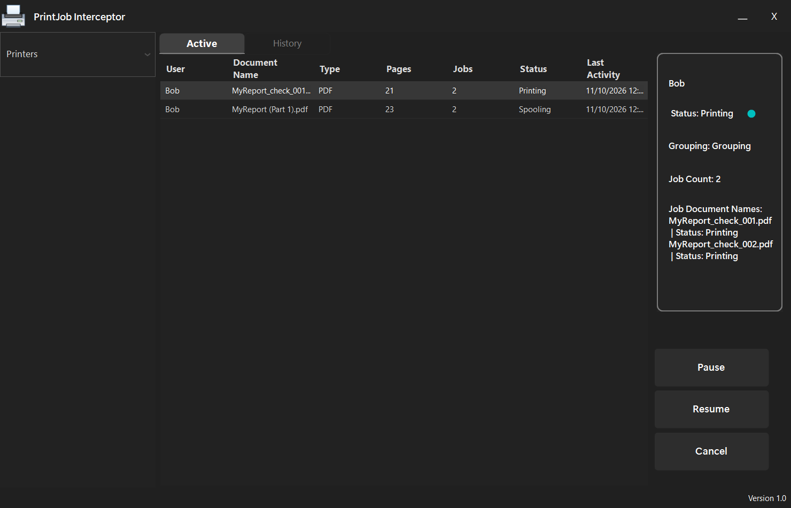
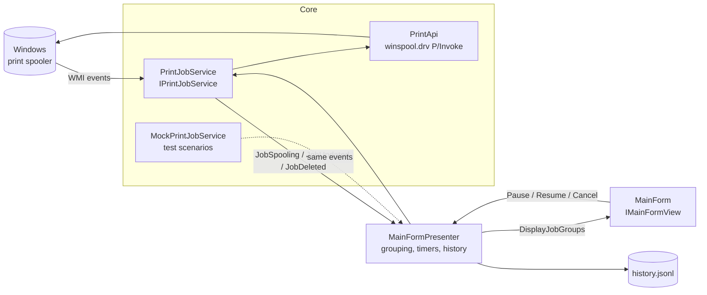
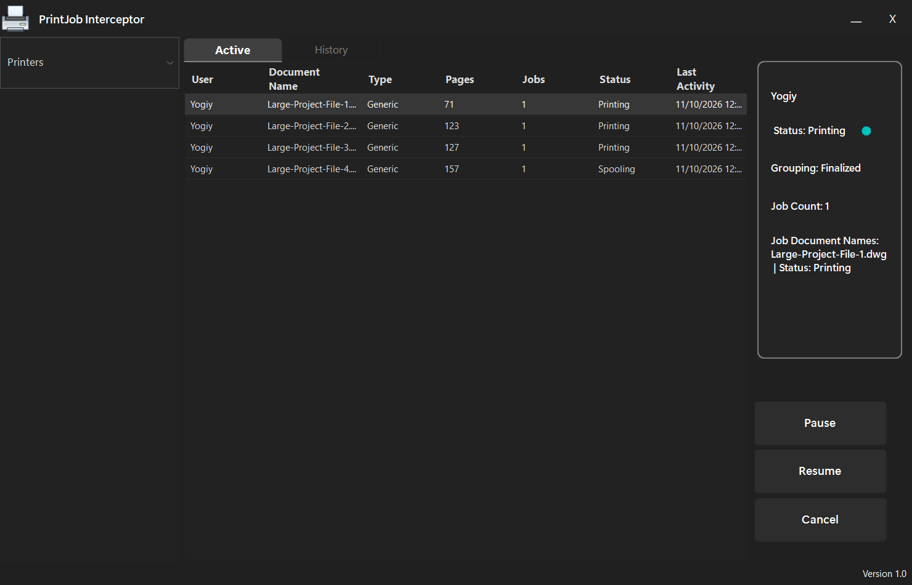
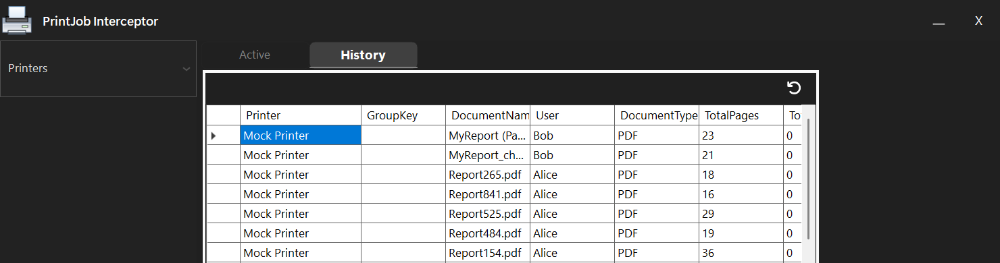

# PrintJob Interceptor

A Windows desktop tool that watches the print spooler in real time, groups the parts of one document into a
single job, and lets you pause, resume or cancel them.

Built in October and November 2025 as a take-home assignment for a software engineering interview.



*`MyReport_check_001.pdf` and `_002.pdf` fold into one group, and so do `MyReport (Part 1)` and `(Part 2)`.
The panel on the right shows the group's state and every job inside it.*

---

## What it does

| Feature | How |
|---|---|
| **Live monitoring** | WMI event watchers on `Win32_PrintJob` for creation, modification and deletion. No polling loop in the app. |
| **Document grouping** | Jobs with the same user and the same base document name join one group. `_001`, `_002` and `(Part 2 of 3)` suffixes are stripped. A group stays open for 5 s after its last activity, then it is finalised. |
| **Job control** | Pause, resume or cancel a whole group at once through the Win32 spooler API (`OpenPrinter` / `SetJob` in `winspool.drv`). |
| **Printer filter** | Show jobs from selected printers only. |
| **Stuck-job sweep** | A job that has shown "Printing" or "Spooling" for over 15 s and no longer exists in the spooler is marked completed, so the list never hangs on a ghost job. |
| **History** | Finished, cancelled or failed groups are appended to `%APPDATA%\PrintJobInterceptor\history.jsonl`. |
| **Test mode** | A mock print service and a scenario window replay realistic print traffic, so the app can be shown and tested without a printer. |
| **Logging** | Serilog to the console, the debugger and a rolling file (10 MB per file, last 5 kept). |

## Architecture

Model-View-Presenter on WinForms, wired with `Microsoft.Extensions.DependencyInjection`.



- **Core** holds the models (`PrintJob`, `PrintJobGroup`) and the services. `PrintJobService` turns WMI events
  into plain C# events; `PrintApi` wraps the three spooler calls.
- **Presenter** owns all state: the job groups, the grouping timeout, the stuck-job sweep and the history writer.
  It knows the view only through `IMainFormView`.
- **View** draws the lists and raises user intents. It holds no business logic.
- The service is chosen at start-up: the real one, or the mock in test mode. The presenter and the view do not
  change.

## Design decisions

| Decision | Why | Trade-off |
|---|---|---|
| WMI events instead of polling the spooler | Event-driven and fully managed: no handle juggling in the app | WMI reports with up to 1 s delay (`WITHIN 1`) and costs more than the native change-notification API |
| MVP with interfaces | The presenter can be tested and the service swapped without touching the UI | More files than a single form with code-behind |
| Group key = user + base document name, closed by a timeout | Catches the common ways applications split one document into several jobs | A heuristic: two unrelated documents with the same base name from the same user within 5 s would merge |
| One lock around the shared group dictionary | WMI events arrive on thread-pool threads while the UI timer reads the same data | Coarse locking; fine at desktop job volumes |
| Append-only JSON Lines for history | Simple, crash-tolerant (one line per group), readable in any editor | No querying; a database would be the next step |

## Screenshots

| Live jobs | History |
|---|---|
|  |  |

## Run it

Requirements: Windows 10 or 11 and the [.NET 9 SDK](https://dotnet.microsoft.com/download/dotnet/9.0).

```powershell
git clone https://github.com/YogiOnCode/PrintJobInterceptor.git
cd PrintJobInterceptor
dotnet run -c Release
```

The app starts in **test mode**: a second window lets you pick a scenario and press *Run Test*.

| Scenario | What it shows |
|---|---|
| `InteractiveTest` | Five large jobs, 4 s apart, long enough to try Pause, Resume and Cancel |
| `GroupedJobWithTimeout` | Three parts of one report grouped, then a late part that starts a new group after the 5 s timeout |
| `SequentialJobNames` | `_001` / `_002` and `(Part 1)` / `(Part 2)` names grouped; one pair is cancelled |
| `SingleJobs` | Two unrelated jobs that stay separate |

To watch the real spooler, set `IS_TEST_MODE = false` in `Program.cs` and print something.

## Project structure

```
Core/
  Interfaces/IPrintJobService.cs      contract shared by the real and the mock service
  Models/                             PrintJob, PrintJobGroup (group status rules)
  Services/PrintJobService.cs         WMI watchers and job control
  Services/PrintApi.cs                winspool.drv P/Invoke
  Services/MockPrinterJobServices.cs  simulated print traffic
  Services/Helper/                    test scenarios and their window
Presentation/MainformPresenter.cs     grouping, timers, history
UI/                                   view interface and UI helpers
MainForm.cs                           the main window
Program.cs                            DI set-up, logging, test mode switch
```

## Limitations and next steps

- **History storage.** JSON Lines works for a log but cannot be queried. SQLite would allow search and filters.
- **History serialisation.** Some fields are excluded with `[JsonIgnore]` to keep runtime state out of the file.
  A dedicated history record type would be cleaner.
- **Restart a job.** The spooler supports it (`JobCommand.Restart` is already defined) but it is not in the UI yet.
- **Tests.** The presenter is built for unit tests; the next step is a test project around the grouping rules.

## Tech stack

C# · .NET 9 · WinForms (MVP) · WMI (`System.Management`) · Win32 spooler API · Microsoft.Extensions.DependencyInjection ·
Serilog · Newtonsoft.Json · Siticone UI · FontAwesome.Sharp
